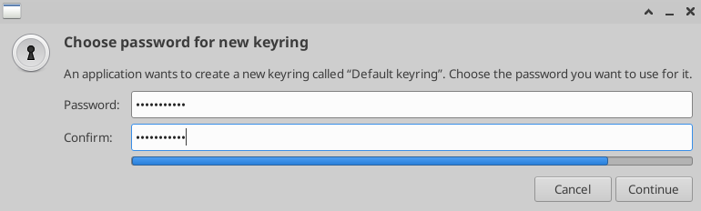

# DevOps (C3DO1A) Spring 2026

This is the repository for the DevOps (Spring 2027) course at Borås University.

The course schedule can be found on [Kronox](https://schema.hb.se/setup/jsp/Schema.jsp?startDatum=2026-03-30&intervallTyp=a&intervallAntal=1&sprak=EN&sokMedAND=true&forklaringar=true&resurser=k.C3DO1A-20261-I16V6-) and the course material can be found on [Canvas](https://hb.instructure.com/courses/11155).

**Note:** If you are using one of the university's virtual machines, you can skip ahead to [Accounts](#accounts).

## Software

Install the following software on your computer:

- [Visual Studio Code](https://code.visualstudio.com)
- [Miniconda](https://docs.anaconda.com/miniconda/install/#quick-command-line-install)
- [Git](https://git-scm.com/downloads)
- [.NET Sdk](https://dotnet.microsoft.com/en-us/download) (install .net version 9.0 and 10.0)
- [Docker Desktop](https://docs.docker.com/desktop) (or [Docker Engine](https://docs.docker.com/engine) if on Linux)
- [Minikube](https://minikube.sigs.k8s.io/docs/start)
- [kubectl](https://kubernetes.io/docs/tasks/tools)
- [Packer](https://developer.hashicorp.com/packer/install)
- [Terraform](https://developer.hashicorp.com/terraform/install)
- [Ansible](https://docs.ansible.com/projects/ansible/latest/installation_guide/installation_distros.html)
- [GitHub CLI](https://cli.github.com)
- [Azure CLI](https://learn.microsoft.com/en-us/cli/azure)
- [Tea (Gitea CLI)](https://gitea.com/gitea/tea)

## Verify the Software Installation

Verify the software has been successfully installed, by opening a terminal and issuing the following commands (each command should print out a version):

- `code --version`
- `conda --version`
- `git --version`
- `dotnet --version`
- `docker --version`
- `minikube version`
- `kubectl version`
- `packer --version`
- `terraform --version`
- `ansible --version`
- `gh --version`
- `az --version`
- `tea --version`

If you don't see the print-out of a version for a specific tool, make sure the path to your tool has been added to your `PATH` environment variable.

Also, if you are on Windows or MacOS, search for `Docker Desktop` among your installed applications, and start it. Make sure Docker Desktop starts without any issues.

## Accounts

Create a GitHub, Docker and Azure for Students account (if you don't already have one):

- Visit the [GitHub](https://github.com) web site and [Sign up](https://github.com/signup) for an account.
- Visit the [Docker](https://www.docker.com) web site and [Sign up](https://app.docker.com/signup) for an account.
- Visit the [Azure for Students](https://azure.microsoft.com/en-us/free/students) sign up page, click the `Start free` button, and sign up for an account.

## Course Repository

When you have installed the software above, open a **terminal** and clone the GitHub repository [C3DO1A_2026](https://github.com/paga-hb/C3DO1A_2026) to your computer, and create a Python environment.

**Note:** If you are on one of the universitiy's virtual machines, you can open a **terminal** via the main menu: `Applications` $\rightarrow$ `Terminal Emulator`

- `git clone https://github.com/paga-hb/C3DO1A_2027.git devops`
- `cd devops`
- `conda create -y -p ./.conda python=3.12`
- `conda activate ./.conda`
- `python -m pip install --upgrade pip`
- `pip install ipykernel jupyter`

## Open the First Workshop Notebook

Finally, make sure you are in the `devops` folder in your terminal, and open the first notebook in Visual Studio Code, by issuing the command below:

- `code -g workshop1/01-environment.ipynb:0 .`

When the notebook opens in VSCode, click the text `Select Kernel` (in the top-right of the notebook), and choose `Python Environments... => conda (Python 3.12) .conda/bin/python`.

Now you can follow the instructions in the notebook to set up the development environment for this course.

## Note

If you are on one of the university's virtual machines, you can open **Visual Studio Code (VSCode)** via the main menu: `Applications` $\rightarrow$ `Development` $\rightarrow$ `Visual Studio Code`

When you start **Visual Studio Code (VSCode)** on one of the university's virtual machines, you will be prompted to enter your **virtual machine user's password** to create a new keyring.

